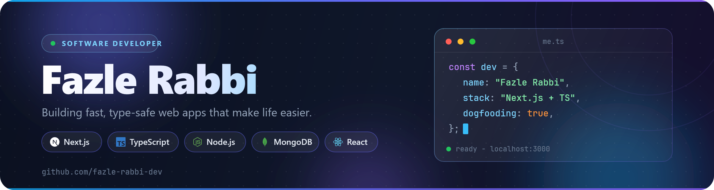

<!-- ========================= HEADER ========================= -->
<!--  -->



<div>

<div align="center">

<a href="https://github.com/fazle-rabbi-dev">
  
</a>

<p align="center">
  
  
  
</p>

<p align="center">
  <a href="https://your-portfolio.com"></a>
  <a href="https://linkedin.com/in/YOUR_HANDLE"></a>
  <a href="mailto:you@example.com"></a>
  <a href="https://x.com/YOUR_HANDLE"></a>
</p>

</div>

---

## About Me

I'm a software developer who enjoys building software that makes everyday life a little easier, including my own.

I specialize in web development, mostly with the MERN stack and Next.js, and I also build mobile and desktop apps. What excites me most is creating something useful, even if it's a tiny app. I've built a prayer time app, a small calculator, and a YouTube video summarizer, and I use all of them myself. I want to bring software into every aspect of life.

```ts
const me = {
	role: "Software Developer (Web)",
	stack: ["Next.js", "TypeScript", "Node.js", "MongoDB", "React"],
	focus: ["Frontend mastery", "Fullstack in Next.js", "Minimal, type-safe code"],
	currently: "Building apps continuously with Next.js",
	learning: "Just-in-time. Learn it when the project needs it.",
	funFact: "I dogfood every app I ship",
} as const;
```

---

## 📍 Featured Projects

<table>
  <tr>
    <td width="33%" valign="top">
      <h3>🕌 Prayer Time App</h3>
      <p>Accurate daily prayer times with aesthetic vibe. Built because I needed it.</p>
      <p>        
        
        
      </p>
      <!-- <a href="#">Code</a> •  -->
      <a href="https://noor-prayer.surge.sh/">Live</a>
    </td>
    <td width="33%" valign="top">
      <h3>🌿 Link Leaf</h3>
      <p>Complete working feature rich bio-link/linktree web app.</p>
      <p>
       
        
        
      </p>
      <a href="https://github.com/fazle-rabbi-dev/link-leaf">Code</a> • <a href="https://link-leaf.vercel.app">Live</a>
    </td>
    <td width="33%" valign="top">
      <h3>▶️ YouTube Summarizer</h3>
      <p>Paste a video link, get the key points. Saves hours of watching.</p>
      <p>
        
        
        
      </p>
      <a href="https://github.com/fazle-rabbi-dev/tube-brief">Code</a> • <a href="https://tube-brief.vercel.app">Live</a>
    </td>
  </tr>
</table>

---

## Tech Stack

<!--

<p>
  

  

  

  

  

  

  

  

  

  

  
</p>
 -->

<div>


</div>

---

## What I'm Doing

- **Rapid prototyping** - Full apps in days, not months
- **Agentic development** - Exploring AI capabilities and new paradigms in software
- **Personal software** - Building tools that make my life easier

## Latest Blog Posts

<!-- BLOG-POST-LIST:START -->

- [Learn software development with Android phone](https://quiet-stack.vercel.app/blog/complete-guideline-to-learn-app-or-web-development-using-an-android-phone)
- [This productivity app will make you a superhuman](https://quiet-stack.vercel.app/blog/secret-productivity-app-pto-moxt9j)
- [10 AI Orchestration/ADE Apps for Desktop](https://quiet-stack.vercel.app/blog/ai-orchestrationade-apps-for-desktop-_4qpor)

 <!-- BLOG-POST-LIST:END -->

[**Read all posts →**](https://quiet-stack.vercel.app/)

## GitHub Activity


<!--
 -->

### 📍 Most Used Languages

```
JavaScript  •  TypeScript  •  Html
```

## Let's Connect

I'm open to collaborations, freelance work, and good conversations about web dev.

<p align="">
  <a href="https://https://fazle-rabbi-dev.vercel.app/"></a>
  <a href="https://linkedin.com/in/fazlerabbidev"></a>
  <a href="mailto:fazlerabbi1343@gmail.com"></a>
  <a href="https://x.com/fazle_rabbi_dev"></a>
</p>

## Philosophy

> "Ugly action beats perfection" - Following the rule: "Just make it exist first. You can always make it good later."

<div align="center">


</div>
