<!-- Intro -->
<h1>
Meet
  
  <a href="https://fazle-rabbi-dev.vercel.app/" target="_blank">Rabbi</a> 👋

</h1>

  <b>📍 Based in Bangladesh | 🤖 Building software with agents
  </b>

  <i>
    A software developer who enjoys building software that makes everyday life a little easier
  </i>

<!-- Links -->

  

<!-- Favourite Technologies Badge -->

  
  
  
  
  
  
  

<!-- Stats -->
<!-- 

  
  
  

 -->

## About Me

I specialize in web development, mostly with the MERN stack and Next.js, and I also build mobile and desktop apps. What excites me most is creating useful software that improves human life, even if it's a tiny app. I've built a prayer time app, a small calculator, and a YouTube video summarizer, and I use all of them myself.

## ⭐ Featured Projects

  
  

## Tech Stack

  
  
  
  
  
  
  
  
  
  
  
  
  
  
  
  

<!--
 -->

<!-- top used languages card -->
<!-- 

 -->

## 🏝️ What I'm Doing

- **Rapid prototyping** - Full apps in days, not months
- **Agentic development** - Exploring AI capabilities and new paradigms in software
- **Personal software** - Building tools that make my life easier

<!--
## Most Used Languages

  
  
  
  

 -->

## Latest Blog Posts

<!-- BLOG-POST-LIST:START -->

- [Learn software development with Android phone](https://quiet-stack.vercel.app/blog/complete-guideline-to-learn-app-or-web-development-using-an-android-phone)
- [This productivity app will make you a superhuman](https://quiet-stack.vercel.app/blog/secret-productivity-app-pto-moxt9j)
- [10 AI Orchestration/ADE Apps for Desktop](https://quiet-stack.vercel.app/blog/ai-orchestrationade-apps-for-desktop-_4qpor)

 <!-- BLOG-POST-LIST:END -->

[**Read all posts →**](https://quiet-stack.vercel.app/)

<!-- ## GitHub Activity

 -->

<!--
 -->

## Let's Connect

I'm open to collaborations, freelance work, and good conversations about web dev.

  
  
  
  

## Philosophy

> "Ugly action beats perfection" - I just make things exist first, then make them good later."

